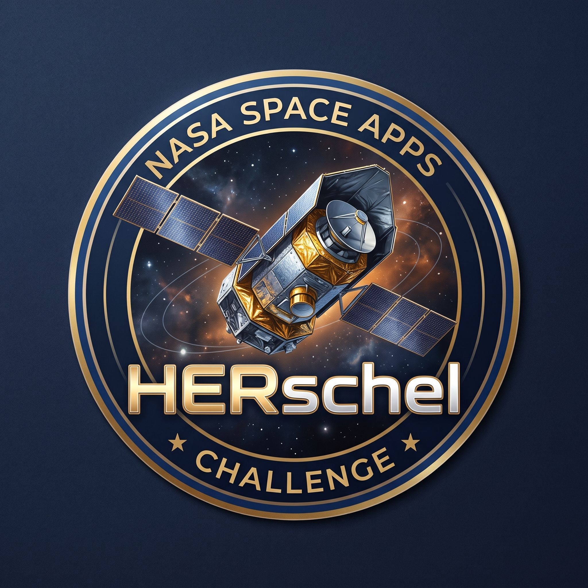

<p align="center">
  
  <br><sub><i>AI-generated team logo</i></sub>
</p>

<h1 align="center">SPHEREx-EYE</h1>

<p align="center">
  <b>Multi-epoch blink comparison and anomaly detection pipeline for infrared sky surveys</b><br>
  NASA Space Apps Challenge 2026 · Baku Local Event · Challenge: <b>Planet X and SPHEREx</b>
</p>

<p align="center">
  
  
  
  
  
</p>

<p align="center">
  <a href="https://spherex-eye-nasa-2026.onrender.com/"><b>▶ Live Demo</b></a>
</p>

> The live demo is hosted on Render's free tier. The first request after inactivity may take up to a minute while the service starts.

---

## Table of Contents

- [Overview](#overview)
- [Key Features](#key-features)
- [System Architecture](#system-architecture)
- [Processing Pipeline](#processing-pipeline)
- [Data Sources](#data-sources)
- [Repository Structure](#repository-structure)
- [Installation](#installation)
- [Usage](#usage)
- [API Reference](#api-reference)
- [Output Format](#output-format)
- [Validation](#validation)
- [Validation Results](#validation-results)
- [Known Limitations](#known-limitations)
- [Roadmap](#roadmap)
- [Team](#team)
- [Acknowledgements](#acknowledgements)
- [Use of Super Intelligence (AI)](#use-of-super-intelligence-ai)

---

## Overview

SPHEREx-EYE is a web-based research prototype that compares sky images of the same field taken at different epochs, detects sources that changed position, and produces a structured assessment for each candidate.

The system combines:

- **Astrometric change detection** on FITS images retrieved from NASA SkyView (DSS1, DSS2, 2MASS, WISE).
- **Cross-matching** against the ESA Gaia DR3 catalogue via the Gaia TAP service.
- **Spectral classification** over a SPHEREx-style 102-channel grid (0.75–5.00 µm) using absorption band-depth analysis (H₂O, CH₄, CO₂, CO, silicate).
- **An interactive frontend** with a blink comparator, candidate list, spectral energy distribution (SED) chart, and exportable candidate reports.

Target object classes: high proper-motion stars, asteroid and trans-Neptunian object (TNO) candidates, brown dwarf candidates, and Planet X / Planet 9-type candidates.

> **Scope note:** SPHEREx-EYE is a prototype. All detections are reported as *candidates* with `needs_review` status. Results are not validated scientific discoveries.

---

## Key Features

| Feature | Description |
|---|---|
| Multi-epoch FITS retrieval | Downloads two epochs of a target field from NASA SkyView with survey fallbacks and local caching. |
| Image registration | Global shift estimation by phase correlation, followed by affine warping. |
| Difference imaging | Normalization, absolute differencing, thresholding, and morphological filtering to isolate changed sources. |
| Candidate pairing | Matches source centroids between epochs within configurable shift and area limits. |
| Gaia DR3 cross-match | Live TAP cone search (0.05°) returning source ID, proper motion, parallax, and G magnitude. |
| 102-band spectral classifier | Continuum-normalized band-depth measurement for ice and mineral absorption features. |
| SNR estimation | Aperture photometry (`candidate_snr`) and peak-over-background (`snr_peak`) methods. |
| WCS conversion | Converts pixel centroids to RA/Dec when FITS headers contain valid WCS. |
| Interactive comparator | Blink, Epoch 1, Epoch 2, Residual Difference, and Opacity Mix views with WCS grid overlay. |
| Candidate reports | Per-candidate dossier with JSON export and printable PDF mission report. |
| Custom data upload | Compare any two user-supplied `.fits`, `.fit`, `.png`, or `.jpg` images. |
| Offline fallback | Generates a calibrated synthetic field when SkyView is unreachable; clearly labelled in the UI. |
| CSV export | All analysed candidates written to `candidates.csv`. |

---

## System Architecture

```text
┌──────────────────────────┐
│  Frontend (index.html)   │  Tailwind CSS · Chart.js · vanilla JS
└────────────┬─────────────┘
             │ REST / JSON
┌────────────▼─────────────┐
│  FastAPI backend         │  backend/app/main.py
└──┬──────────┬─────────┬──┘
   │          │         │
   ▼          ▼         ▼
NASA       ESA Gaia   Local FITS cache
SkyView    DR3 TAP    (cache/fits/)
   │          │
   └────┬─────┘
        ▼
┌──────────────────────────┐
│ Detector (OpenCV)        │  alignment · differencing · pairing
├──────────────────────────┤
│ DS integration           │  WCS · proper motion · SNR · review status
├──────────────────────────┤
│ Spectral classifier      │  102-band absorption analysis
└────────────┬─────────────┘
             ▼
   JSON response · candidates.csv · PDF/JSON report
```

---

## Processing Pipeline

1. **Target and epoch selection** – user selects a predefined target and an epoch mode, or uploads two images.
2. **FITS acquisition** – `nasa_fetcher.py` checks the local cache, otherwise queries NASA SkyView (15′ field, 600 × 600 px, ≈1.5″/px). Cached files are validated (exists, valid FITS, 2-D, non-empty).
3. **Registration** – `cv2.phaseCorrelate` estimates the global offset; `cv2.warpAffine` aligns Epoch 2 to Epoch 1.
4. **Normalization** – both epochs scaled to 0–255 to compensate for differing survey response (e.g. DSS1 optical vs DSS2 IR).
5. **Difference map** – `cv2.absdiff`, thresholding, morphological opening, dilation, contour extraction.
6. **Candidate pairing** – centroids paired across epochs with filters: shift 6–320 px (on ≥500 px wide-field plates), contour area 4–1200 px.
7. **Characterization** – angular shift, proper motion, SNR, spectral class and confidence, Gaia match.
8. **Classification** – rule-based assignment to *Planet X Candidate*, *High-PM / TNO Candidate*, or *Infrared Excess / Brown Dwarf*.
9. **Output** – JSON to frontend, row per candidate in `candidates.csv`.

**Performance:** a full scan completes in under 2 seconds end to end once the target's FITS files are cached locally. This relies on local FITS caching, a single WCS object reused across all candidates, and bounded local windows for SNR and bright-star halo checks instead of full-frame operations. The first run for a new target is slower because it downloads from SkyView.

### Epoch modes

| Mode ID | Epoch 1 | Epoch 2 | Baseline |
|---|---|---|---|
| `classic_1953_1996` | DSS1 Red (1953) | DSS2 IR (1996) | 43 years |
| `modern_1996_wise` | DSS2 IR (1996) | WISE 3.4 µm / 2MASS-K / 2MASS-H (2001+) | Modern near-IR |

### Predefined targets

| Target ID | Object | RA (°) | Dec (°) |
|---|---|---|---|
| `barnard_star` | Barnard's Star | 269.45 | +4.69 |
| `pleiades_ir` | M45 Pleiades | 56.75 | +24.11 |
| `sedna_region` | 90377 Sedna sector | 54.12 | +7.85 |
| `kapteyn_star` | Kapteyn's Star | 77.92 | −45.02 |
| `proxima_cen` | Proxima Centauri | 217.43 | −62.68 |

### Spectral features

| Species | Bands (µm) |
|---|---|
| H₂O ice | 1.5, 2.0, 3.0 |
| CH₄ ice | 1.72, 2.32, 3.32 |
| CO₂ ice | 4.27 |
| CO ice | 4.67 |
| Silicate | ~1.0 (weak indicator only; the primary 9.7 µm band lies outside the SPHEREx range) |

---

## Data Sources

| Source | Provider | Usage |
|---|---|---|
| [SkyView Virtual Observatory](https://skyview.gsfc.nasa.gov/) | NASA GSFC | DSS1, DSS2, 2MASS, WISE FITS cutouts |
| [Gaia DR3](https://www.cosmos.esa.int/web/gaia/dr3) | ESA | Astrometric cross-match (TAP service) |
| [SPHEREx](https://www.jpl.nasa.gov/missions/spherex/) | NASA / JPL / Caltech | Reference spectral range and channel layout (0.75–5.00 µm, 102 bands) |

---

## Repository Structure

```text
SPHEREx-EYE-NASA-2026/
├── backend/
│   ├── app/
│   │   ├── ai/
│   │   │   ├── nasa_fetcher.py         # SkyView FITS retrieval, cache, Gaia DR3 TAP, offline fallback
│   │   │   ├── detector.py             # Alignment, differencing, candidate pairing, classification
│   │   │   ├── spectral_classifier.py  # 102-band classifier, SNR, detection metrics
│   │   │   ├── ds_integration.py       # WCS, proper motion, review status, CSV export
│   │   │   └── validate.py             # Synthetic validation suite
│   │   └── main.py                     # FastAPI application and endpoints
│   └── requirements.txt
├── frontend/
│   └── index.html                      # Single-page UI
├── candidates.csv                      # Latest analysis output
├── logo.png
└── README.md
```

---

## Installation

**Requirements:** Python 3.10+, internet access for NASA SkyView and Gaia TAP (optional; offline fallback available).

```bash
git clone https://github.com/Alijewa25/SPHEREx-EYE-NASA-2026.git
cd SPHEREx-EYE-NASA-2026

python -m venv venv
# macOS / Linux
source venv/bin/activate
# Windows (PowerShell)
.\venv\Scripts\Activate.ps1

pip install -r backend/requirements.txt
```

### Dependencies

| Package | Version | Purpose |
|---|---|---|
| fastapi | 0.115.0 | REST API |
| uvicorn | 0.30.6 | ASGI server |
| numpy | 1.26.4 | Numerical computation |
| opencv-python-headless | 4.10.0.84 | Image registration and differencing |
| pillow | 10.4.0 | Raster image I/O |
| astropy | 6.1.3 | FITS and WCS handling |
| astroquery | 0.4.7 | Astronomical archive access |
| requests | 2.32.3 | HTTP requests to SkyView and Gaia |
| python-multipart | 0.0.9 | File upload handling |

---

## Usage

Start the server from the repository root:

```bash
uvicorn backend.app.main:app --reload
```

Open **http://127.0.0.1:8000** in a browser. The backend serves the frontend and `logo.png` directly.

Interactive API documentation: **http://127.0.0.1:8000/docs**

### Workflow

1. Select a target and an epoch baseline (scan starts automatically).
2. Inspect the field using Blink, Epoch 1, Epoch 2, Residual Diff, or Opacity Mix views.
3. Select a candidate in *Motion Detections* or on the image.
4. Review the 102-band SED chart and the Gaia DR3 panel.
5. Open the candidate dossier; export as JSON or print to PDF.

### Run validation

```bash
python backend/app/ai/validate.py
```

---

## API Reference

| Method | Endpoint | Description |
|---|---|---|
| `GET` | `/api/health` | Service status, band count, data mode |
| `GET` | `/api/targets` | Available targets and epoch modes |
| `GET` | `/api/scan/nasa-live?target=<id>&mode=<mode>` | Full pipeline run on SkyView data |
| `POST` | `/api/scan/upload` | Compare two uploaded files (`epoch1_file`, `epoch2_file`) |

**Example**

```bash
curl "http://127.0.0.1:8000/api/scan/nasa-live?target=barnard_star&mode=classic_1953_1996"
```

Main response fields: `candidates`, `gaia_dr3`, `epoch1_image`, `epoch2_image`, `data_source`, `epoch1_survey`, `epoch2_survey`, `baseline`, `fov_arcmin`, `ra`, `dec`, `fits_metadata`.

`data_source` is reported as `NASA Goddard SkyView // …` for live data and `Calibrated Offline Fallback // …` when synthetic data is used.

Gaia status values: `LIVE TAP` (live query), `BENCHMARK` (stored fallback), `UNAVAILABLE`.

---

## Output Format

`candidates.csv` columns:

```text
candidate_id, ra_deg, dec_deg, survey_epoch1, survey_epoch2, date_obs1, date_obs2,
pixel_scale_arcsec, centroid1_x, centroid1_y, centroid2_x, centroid2_y,
motion_arcsec, pm_arcsec_yr, snr, spectral_class, spectral_source,
confidence, data_source, known_match, review_status
```

`review_status` is `auto_pass` only when epoch dates, pair validation, bright-star halo check, and SNR threshold are all satisfied; otherwise `needs_review`.

Per-candidate telemetry returned to the frontend: `object_type`, `surface_temp_k`, `distance_au`, `tangential_velocity_kms`, `composition_breakdown`, `hazard_level` (`LOW` / `MODERATE` / `HIGH`), `astronaut_brief`.

---

## Validation

`validate.py` runs five test groups on synthetic data:

| Test | Purpose |
|---|---|
| Spectral accuracy | Classification of synthetic H₂O, CH₄, CO₂, CO, silicate, and featureless spectra |
| False alarm | Rate of incorrect class assignment on noise-only spectra |
| SNR | SNR response for synthetic sources of varying amplitude |
| Motion | Expected pixel displacement for known high proper-motion stars (15′ FOV, 600 px) |
| Detection metrics | Precision, recall, F1 |

These tests verify internal consistency. They do not constitute validation against astronomical ground truth.

---

## Validation Results

Quantitative analysis by the Data Science module (`spectral_classifier.py`, `ds_integration.py`, `validate.py`). Output of `python backend/app/ai/validate.py`.

### 1. Spectral classification accuracy (200 synthetic spectra per class)

| Noise σ | H₂O | CH₄ | CO₂ | CO | Silicate | None | Mean |
|---|---|---|---|---|---|---|---|
| 0.005 | 100.0% | 100.0% | 100.0% | 100.0% | 100.0% | 100.0% | 100.0% |
| 0.01 | 100.0% | 100.0% | 100.0% | 100.0% | 100.0% | 99.5% | 99.9% |
| 0.02 | 100.0% | 100.0% | 100.0% | 100.0% | 100.0% | 99.5% | 99.9% |
| 0.05 | 100.0% | 99.5% | 100.0% | 100.0% | 100.0% | 99.5% | 99.8% |

### 2. False-alarm rate (1,000 noise-only spectra)

| Noise σ | False alarms |
|---|---|
| 0.01 | 0.0% (0/1000) |
| 0.02 | 1.3% (13/1000) |
| 0.05 | 1.3% (13/1000) |

### 3. SNR estimator calibration (synthetic sources, background σ = 5)

| Amplitude | Expected SNR | `snr_peak` (mean) | Aperture SNR (mean) |
|---|---|---|---|
| 10 | 2.0 | 3.1 | 4.5 |
| 25 | 5.0 | 5.7 | 10.5 |
| 50 | 10.0 | 10.5 | 20.5 |
| 100 | 20.0 | 20.6 | 40.6 |
| 300 | 60.0 | 61.7 | 120.8 |

`snr_peak` tracks the expected value within ~5% for SNR ≥ 10.

### 4. Expected displacement of reference high proper-motion stars (43-year baseline, 15′ FOV, 1.5″/px)

Proper motions are catalogue values; displacements are computed.

| Target | PM (″/yr) | Motion (″) | Motion (px) | Within field |
|---|---|---|---|---|
| Barnard's Star | 10.3 | 443 | 295 | Yes |
| Kapteyn's Star | 8.6 | 370 | 247 | Yes |
| Proxima Centauri | 3.8 | 163 | 109 | Yes |
| Luhman 16 | 2.8 | 120 | 80 | Yes |
| WISE 0855−0714 | 8.1 | 348 | 232 | Yes |

These values are the reference against which the backend's measured `motion_arcsec` is checked (±10% tolerance).

### 5. Astrometry module self-test (`ds_integration.py`)

Injected source moved by (60, 30) px; DATE-OBS 1953-09-23 → 1996-11-02; scale 1.5″/px.

| Quantity | Expected | Measured |
|---|---|---|
| Motion | 100.6″ | 100.62″ |
| Proper motion | 2.33 ″/yr | 2.334 ″/yr |
| Review status (moving source) | `auto_pass` | `auto_pass` |
| Review status (static source) | `needs_review` | `needs_review` |

### Interpretation

- Results 1–3 and 5 are measured outputs of the pipeline on synthetic inputs with known ground truth.
- Result 4 is computed from published proper motions and defines the expected detection envelope.
- Detection precision/recall on real survey fields against catalogued positions is the next benchmarking step (see [Roadmap](#roadmap)).

---

## Known Limitations

- Spectra are generated from a SPHEREx-style model; real SPHEREx spectral data is not yet ingested.
- Object classification and telemetry (temperature, distance, hazard) are rule-based heuristics, not trained models.
- `detector.py` uses a fixed 0.42″/px scale for `proper_motion_arcsec`, while `ds_integration.py` uses the FITS header pixel scale; these should be unified under WCS.
- The frontend FOV label displays 18.0′ × 18.0′; the backend default is 15.0′.
- CORS is fully open (`allow_origins=["*"]`); restrict before any public deployment.
- Frontend depends on CDNs (Tailwind CSS, Chart.js, Google Fonts).
- Validation is synthetic only.

---

## Roadmap

- [ ] Ingest public SPHEREx spectral data products
- [ ] Benchmark detection precision/recall on real fields against known moving objects and catalogued high proper-motion stars
- [ ] Replace rule-based classification with a trained model
- [ ] Unify astrometry under a single WCS-based computation
- [ ] Add automated tests and CI
- [ ] Pilot evaluation with mission-planning use cases

---

## Team

**Team HERschel** — NASA Space Apps Challenge 2026, Baku

| Name | Role |
|---|---|
| Tahmina Aliyeva | Team Lead · Full-Stack Developer |
| Nigar Aliyeva | Data Scientist · spectral classifier, astrometry and validation modules |
| Saadat Amirzada | UX/UI Designer |
| Khadija Alizada | IT Business Analyst |
| Amina Aliyeva | Presentation & Pitch |

---

## Acknowledgements

- NASA Goddard Space Flight Center — SkyView Virtual Observatory
- ESA — Gaia mission and Gaia Archive
- NASA / JPL / Caltech — SPHEREx mission
- Digitized Sky Survey (DSS), 2MASS, and WISE survey teams
- Astropy, Astroquery, OpenCV, FastAPI, and Chart.js open-source projects

This project was developed for the NASA Space Apps Challenge 2026. It is not an official NASA or ESA product.

---

## Use of Super Intelligence (AI)

AI tools were used in a limited capacity during development for debugging runtime issues, generating boilerplate file structures and documentation drafts, and creating the team logo (`logo.png`, labeled as AI-generated). All code, scientific formulas, and outputs were reviewed and verified by Team HERschel.
